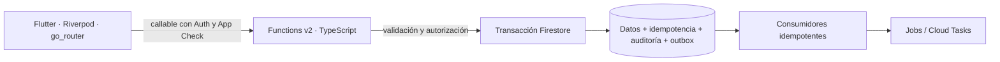

# Lazo

App móvil para Android e iOS de fidelización de clientes y gestión de barberías. El primer negocio previsto es **BlackAndWhite**, con mercados separados para **Perú (PE/PEN)** y **España (ES/EUR)**. La arquitectura admite otros negocios mediante `tenantId → marketId → locationId`.

**Estado actual: Paso 1 — Fundamentos implementados, CI en verde y prueba nativa Android DEMO aprobada.** Se verificaron 119 pruebas de base y una prueba adicional app → servidor: **120 pruebas aprobadas**. El repositorio contiene la base técnica, los contratos y la documentación para desarrollar los siguientes pasos. Todavía no hay registro real, reservas, pagos, estrellas, canjes ni una app publicada para clientes.

La fuente de verdad es **[CONTEXT.md](CONTEXT.md)**: registra lo construido, las decisiones, los contratos, la evidencia y los pendientes. Los resultados locales y remotos, actualizados al 28/10/2026, están en [docs/verification.md](docs/verification.md).

[Repositorio público](https://github.com/MarcoPorras123/lazo) · [GitHub Actions](https://github.com/MarcoPorras123/lazo/actions) · [Issues](https://github.com/MarcoPorras123/lazo/issues)

## Para conocer el proyecto

| Si quieres entender… | Empieza por… |
|---|---|
| Qué existe y qué falta | [CONTEXT.md](CONTEXT.md) y la hoja de ruta de este README |
| Cómo se organiza la solución | [Arquitectura](docs/architecture.md) y [decisiones ADR](docs/adr/) |
| Qué datos y eventos compartirán los módulos | [Modelo de datos](docs/data-model.md), [contratos JSON](packages/contracts/) y sección 3 de CONTEXT |
| Cómo ejecutarlo en tu equipo | [Entornos y ejecución](docs/deployment.md) y [configuración móvil](docs/mobile.md) |
| Qué se ha probado realmente | [Informe de verificación](docs/verification.md) |
| Cómo se protegen datos y operaciones | [Seguridad, IAM y recuperación](docs/security.md) |
| Cómo colaborar sin perder decisiones | [CONTRIBUTING.md](CONTRIBUTING.md) |

## Alcance entregado

- Monorepo con Flutter/Dart y Cloud Functions de segunda generación en TypeScript.
- Variantes móviles `dev`, `staging` y `prod`, con identificadores Android/iOS distintos y configuración independiente.
- Esqueleto de sesión, navegación por rol, localización `es-PE`/`es-ES` y tema provisional.
- Diagnóstico en dev/staging y callable `system.ping`, cuyo nombre desplegable es `system-ping`.
- Money con enteros, PEN/EUR, aritmética exacta, control de overflow y redondeo explícito; tiempo UTC/IANA y reloj inyectable.
- Errores tipados, correlación y cliente callable con tiempos de espera y reintentos que conservan la clave de idempotencia.
- Idempotencia transaccional, auditoría, outbox con deduplicación/reintentos, autorización por alcance y trabajos diferidos DEMO.
- Reglas Firestore y Storage con denegación por defecto; seed local protegido contra producción.
- Diseño de **43 colecciones, 34 índices compuestos, 21 eventos y 7 ADR**. Los contratos de negocio diseñados todavía no son funcionalidades habilitadas.
- Workflow de CI para pruebas, análisis y compilaciones Android/iOS por variante: ocho jobs aprobados, incluidas las tres variantes en ambas plataformas.

## Arquitectura y reglas que deben conservarse



La app presenta información y recoge intenciones. El servidor decide disponibilidad, precios finales, descuentos, pagos, reembolsos, estrellas, canjes, permisos y caja. Una guarda de navegación nunca reemplaza autorización.

Los importes usan unidades mínimas enteras y moneda: `3500 PEN` representa `S/ 35,00`. Los instantes se almacenan en UTC; fechas de negocio, horarios y cierres se calculan con la zona IANA del local. La zona del teléfono no decide reglas de negocio. Perú y España conservan su separación; la vista General analítica futura del dueño podrá combinar agregados con su moneda y contexto.

Toda mutación acepta una clave de idempotencia. Operación, respuesta, auditoría y eventos se escriben en la misma transacción. Los consumidores toleran eventos repetidos y desordenados. Los efectos externos requerirán además deduplicación y reconciliación específicas del proveedor.

El dueño es el único administrador. Los peluqueros entrarán por invitación y el registro público solo creará clientes; esos recorridos corresponden al Paso 3.

## Organización del repositorio

```text
apps/mobile/
  lib/app/                   Arranque, variantes, router, tema y localización
  lib/core/                  Dinero, tiempo, errores y networking
  lib/features/              Diagnóstico y esqueleto de sesión
  android/ · ios/             Proyectos nativos y variantes
  test/ · integration_test/   Pruebas unitarias, widgets y humo nativo preparado
backend/
  functions/src/             Módulos del servidor y utilidades shared
  functions/test/            Pruebas unitarias y de Firestore Emulator
  firestore/                 Reglas, índices y pruebas de acceso
  scripts/                   Emuladores, seed DEMO, despliegue y migraciones
packages/contracts/fixtures/ Ejemplos JSON leídos por Dart y TypeScript
docs/                        Arquitectura, ADR, datos, móvil, seguridad y operación
.github/workflows/ci.yml     Verificación automatizada prevista
CONTEXT.md                   Estado y continuidad entre pasos
```

Los módulos de servidor son `identity`, `authorization`, `bookings`, `payments`, `loyalty`, `wallet`, `notifications`, `waitlist`, `cashbox`, `reporting`, `integrations` y `shared`. Los directorios de negocio registran sus límites; no contienen flujos comerciales ficticios.

## Requisitos

| Herramienta | Versión fijada / requisito |
|---|---|
| Flutter / Dart | Flutter **3.47.8**, con Dart **3.13.7**; `.fvmrc` |
| Node.js | **22.23.4**; `.nvmrc` |
| Java | **21**, para Firebase Emulator Suite |
| Firebase CLI | **15.34.1**, instalado mediante `npm ci` |
| Android | SDK, licencias aceptadas por su titular y emulador/dispositivo configurado |
| iOS | macOS, Xcode y simulador/dispositivo; firma cuando corresponda |

`package-lock.json` y `apps/mobile/pubspec.lock` fijan las dependencias resueltas. `.tools/`, `node_modules/`, cachés, builds, configuraciones locales y credenciales no forman parte del repositorio. Una copia nueva necesita instalar sus herramientas; el directorio `.tools/` de la máquina de desarrollo no se descarga con Git.

## Inicio rápido: pruebas locales

Clonar el repositorio (rama principal `main`):

```sh
git clone https://github.com/MarcoPorras123/lazo.git
cd lazo
```

Desde esa raíz, con Node 22 y Java 21 disponibles en PATH:

```sh
npm ci
npm run lint
npm test
npm run test:scripts
npm run test:emulator
```

La última orden compila Functions, inicia Auth/Firestore/Functions Emulator, ejecuta integración, reglas, ping y seed, y cierra los emuladores. No ejecutarla mientras otra instancia ocupe sus puertos. Para un arranque lento, la [guía de ejecución](docs/deployment.md) explica `FUNCTIONS_DISCOVERY_TIMEOUT=60`.

En `apps/mobile`, comprobar Dart y Flutter sin dispositivo:

```sh
flutter pub get --enforce-lockfile
dart run build_runner build --delete-conflicting-outputs
flutter gen-l10n
flutter analyze
flutter test
```

## Ejecutar el diagnóstico móvil

En una terminal, desde la raíz: `npm run emulators`. En otra terminal, con Android Emulator iniciado:

```sh
cd apps/mobile
flutter run --flavor dev -t lib/main_dev.dart --dart-define-from-file=config/dev.emulator.json
```

Para iOS Simulator, ejecutar desde macOS y sustituir el archivo por `config/dev.emulator.ios.json`. Android Emulator usa `10.0.2.2`; iOS Simulator usa `127.0.0.1`. Las instrucciones para un teléfono físico están en [docs/mobile.md](docs/mobile.md).

El recorrido previsto es **Fundamentos → Diagnóstico → ping**. La interfaz muestra DEMO cuando usa emuladores. Producción no registra la ruta de diagnóstico. Staging/prod necesitan sus archivos `config/<entorno>.local.json`; una configuración ausente muestra el estado de preparación y no conecta silenciosamente a otro proyecto.

## Datos de demostración

Con los emuladores activos, en PowerShell desde la raíz:

```powershell
$env:GCLOUD_PROJECT = 'demo-lazo'
$env:FIRESTORE_EMULATOR_HOST = '127.0.0.1:8080'
npm run seed:demo
```

En bash: `GCLOUD_PROJECT=demo-lazo FIRESTORE_EMULATOR_HOST=127.0.0.1:8080 npm run seed:demo`.

El seed crea BlackAndWhite DEMO, PE/PEN y ES/EUR, locales ilustrativos Lima/Madrid y ocho servicios con precios DEMO. Incluye reglas propuestas, auditoría y eventos técnicos. El catálogo permanece sin publicar. Repetirlo no duplica la operación y el script rechaza otro proyecto o un host remoto. Estos datos no son precios, horarios ni condiciones comerciales aprobadas.

## Verificación disponible

Evidencia vigente de la [ejecución CI #4](https://github.com/MarcoPorras123/lazo/actions/runs/40537922488), comprobada el **27/10/2026**, y detalle histórico local en [docs/verification.md](docs/verification.md):

| Suite | Resultado |
|---|---:|
| Functions: utilidades y contratos | 41/41 |
| Functions: integración con Firestore Emulator | 14/14 |
| Reglas Firestore | 2/2 |
| Protecciones de despliegue | 4/4 |
| Flutter: utilidades, contratos, reintentos, navegación, widgets y fallos de arranque | 58/58 |
| **Subtotal de base** | **119 pruebas aprobadas** |
| Android dev: app → callable system.ping en emuladores DEMO | 1/1 |
| **Total con humo nativo** | **120 pruebas aprobadas** |

También pasaron TypeScript estricto, ESLint y `flutter analyze`. Se comprobó el ping HTTP callable local y el recorrido seed → Firestore → outbox → trigger → consumidor → recibo de auditoría, sin duplicados.

La [ejecución de GitHub Actions #4](https://github.com/MarcoPorras123/lazo/actions/runs/40537922488), sobre `300c79b`, terminó **8/8 jobs aprobados**: Functions, Flutter y compilaciones debug Android/iOS Simulator para dev/staging/prod. El informe conserva las 116 pruebas locales originales del 26/10, la ejecución #3 aprobada y las correcciones posteriores del arranque DEMO.

La [segunda ejecución de humo nativo](https://github.com/MarcoPorras123/lazo/actions/runs/40611649473), sobre el mismo commit `300c79b`, **pasó**: compiló e instaló el APK, arrancó Android dev, abrió Diagnóstico y comprobó la respuesta tipada de `system.ping` desde Firebase Emulator Suite. El primer intento fallido y su corrección se conservan en el informe. Esta evidencia cubre Android dev con datos DEMO; el arranque iOS, staging/prod y la conexión a Firebase real siguen pendientes.

## Hoja de ruta

| Paso | Objetivo | Estado registrado |
|---|---|---|
| 1 | Fundamentos, contratos, entorno local y verificaciones transversales | Implementado; aceptación externa pendiente |
| 2 | Sistema de diseño y componentes de interfaz | Pendiente |
| 3 | Identidad, roles, invitaciones y mercados | Pendiente |
| 4 | Reservas y disponibilidad | Pendiente |
| 5 | Pagos, cambios y reembolsos | Pendiente |
| 6 | Atención, validación y fidelización | Pendiente |
| 7 | Apple Wallet y Google Wallet | Pendiente |
| 8 | Notificaciones y lista de espera | Pendiente |
| 9 | Caja y reportes | Pendiente |
| 10 | Cierre, validación integral y publicación | Pendiente |

Cada paso mantiene CONTEXT y los contratos de los anteriores. Las reglas comerciales sin aprobar permanecen configurables y documentadas como pendientes.

## Pendientes para completar la aceptación del Paso 1

1. Aprobar la región de datos antes de crear Firestore; `europe-west1` es una propuesta. Separar documentos por país no garantiza residencia física.
2. Crear los tres proyectos Firebase y registrar las seis apps Android/iOS. Los alias `demo-*` actuales sirven para desarrollo local y no representan infraestructura creada.
3. Configurar IAM, App Check, Crashlytics, Cloud Tasks/Scheduler, alertas, PITR y respaldos; verificar su funcionamiento real.
4. Observar el arranque iOS y de staging/prod en ambos sistemas, y ejecutar el ping desde la app contra dev real. Las seis compilaciones debug y el humo Android dev contra emuladores ya pasaron.

Las [ejecuciones de Actions](https://github.com/MarcoPorras123/lazo/actions) y sus resultados están enlazados en el informe de verificación.

La [guía de despliegue](docs/deployment.md) describe las guardias: proyectos distintos, parámetros persistidos coherentes con el entorno, cuentas por proyecto y control adicional para producción. No hay secretos reales en los archivos de ejemplo.

## Colaboración y licencia

Antes de empezar un cambio, leer [CONTEXT.md](CONTEXT.md) y los ADR relacionados. Los cambios de contrato actualizan Dart, TypeScript, fixtures, pruebas y documentación en conjunto. Las propuestas y resultados se revisan mediante cambios pequeños, con evidencia reproducible; detalles en [CONTRIBUTING.md](CONTRIBUTING.md).

La licencia del código propio del proyecto está **pendiente de decisión de sus titulares**. No se ha añadido una licencia MIT, Apache ni otra autorización de reutilización por el hecho de publicar el repositorio. Las dependencias conservan sus propias licencias.
