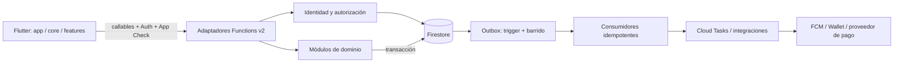
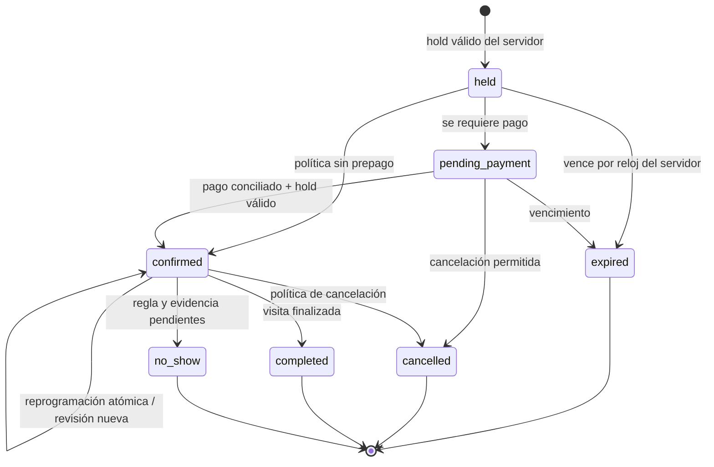
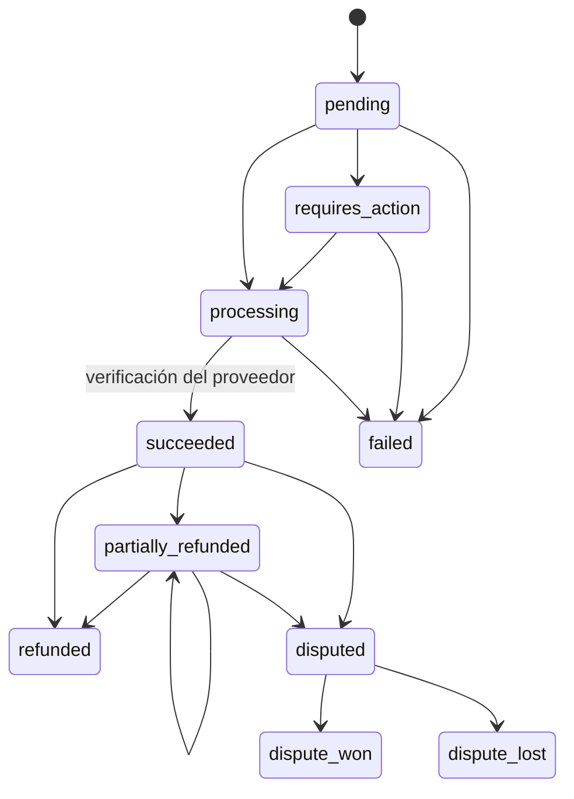
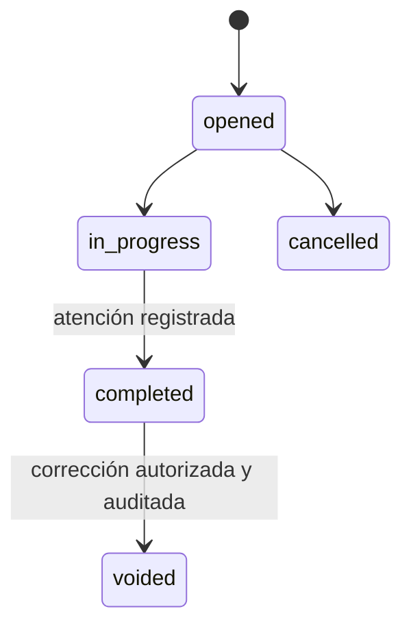
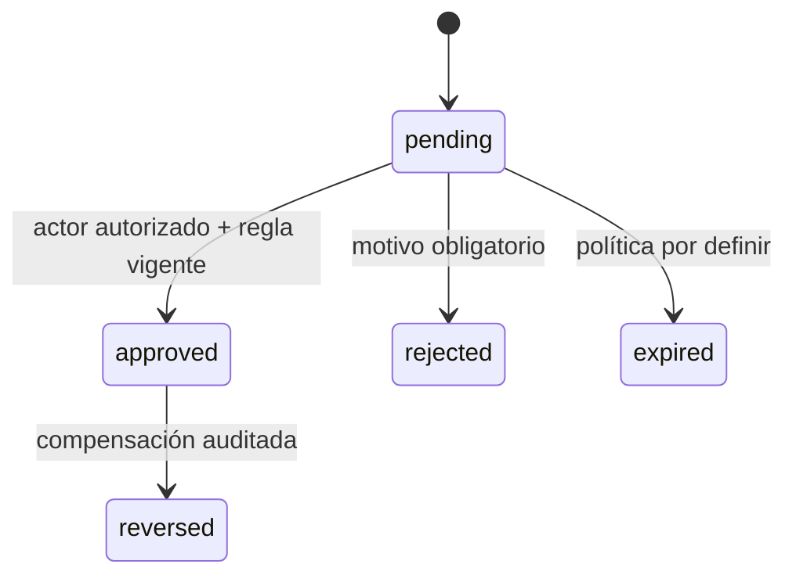
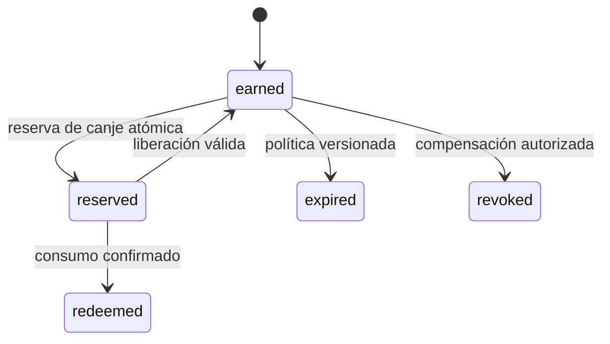
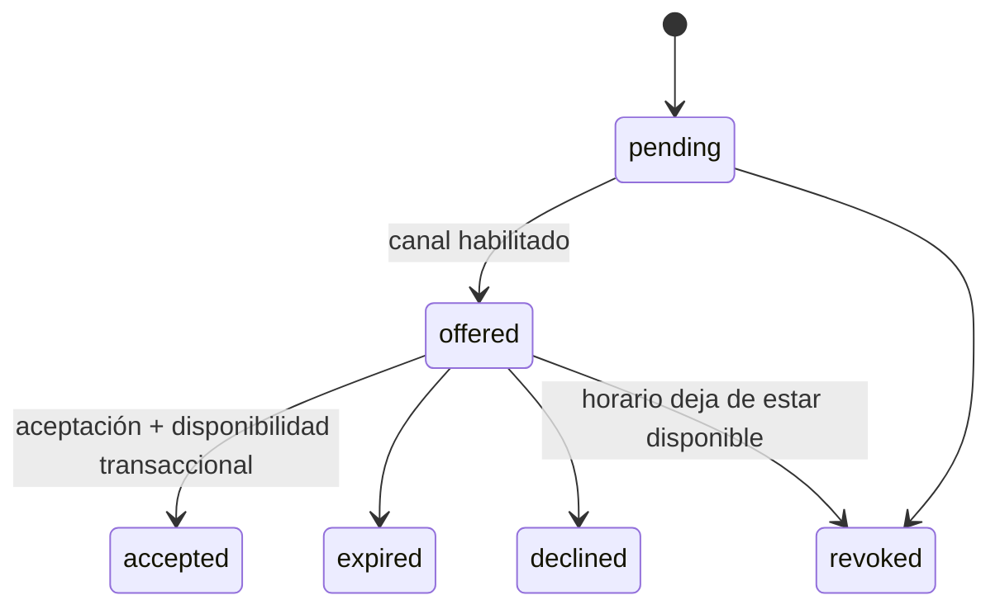
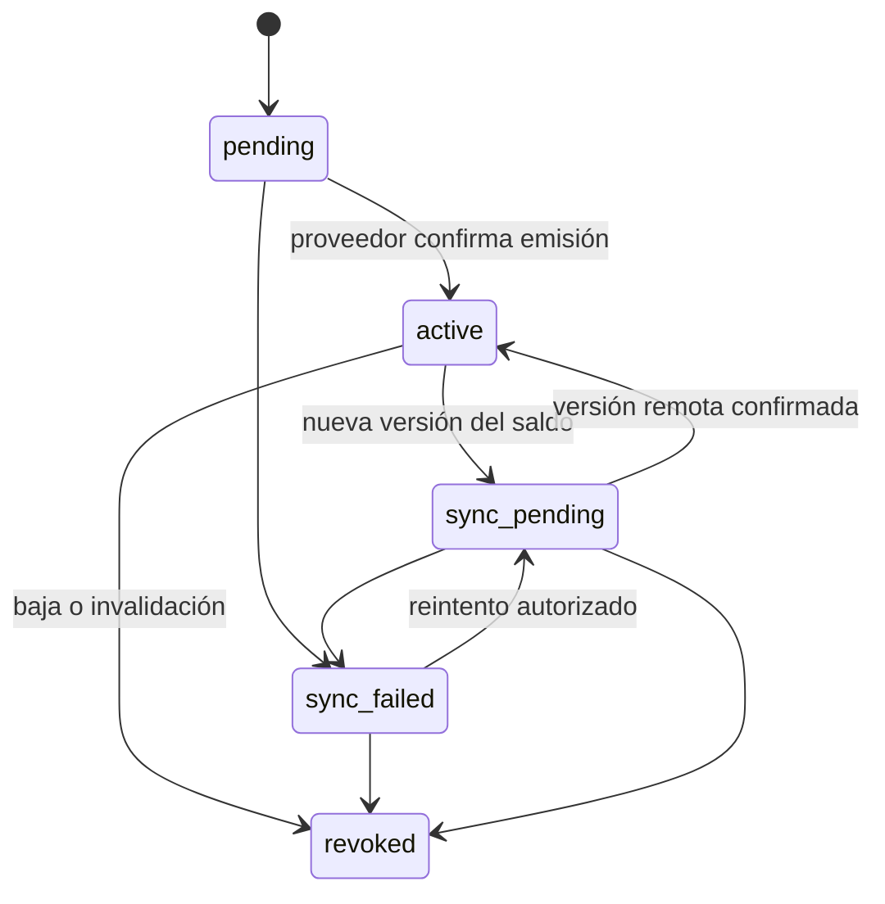

# Lazo — Arquitectura vigente

Diseño inicial: 2026-10-25 · revisión: 2026-10-26 · Paso 1 · fuente de continuidad: [CONTEXT.md](../CONTEXT.md).

## Síntesis previa a la implementación

El Paso 1 prepara un monorepo Flutter/Firebase y un único recorrido de diagnóstico: abrir la app de desarrollo o staging, invocar `system.ping` y mostrar entorno, versión y hora UTC del servidor. No habilita registro, reservas, pagos, fidelización ni acceso operativo a datos.

| Área | Archivos y resultado previsto | Verificación prevista |
|---|---|---|
| App | `apps/mobile/lib/app/`, `core/`, `features/diagnostics/`; entradas dev/staging/prod, sesión vacía, rutas y tema provisionales, ARB es-PE/es-ES | análisis Dart, pruebas de utilidades/contratos, compilación y humo según SDK/dispositivo disponible |
| Servidor | `backend/functions/src/shared/` y módulos del monolito; callable `system.ping`, autorización cerrada, idempotencia, outbox, auditoría y trabajos | TypeScript estricto, linter, pruebas unitarias y emulador |
| Datos | `backend/firestore/`, `packages/contracts/fixtures/`, `docs/data-model.md` | denegación por defecto, auditoría inmodificable por clientes, mismos ejemplos Dart/TypeScript |
| Operación | aliases y parámetros de entorno, CI, scripts de arranque y seed DEMO | protección contra producción, checks reproducibles y evidencia de ejecución |
| Continuidad | `CONTEXT.md`, esta síntesis y `docs/adr/` | contratos y pendientes localizables sin esta conversación |

Las colecciones operativas se diseñan en este paso; no se implementa su comportamiento de negocio. Los documentos compartidos transversales son `idempotencyKeys`, `outbox`, `processedEvents`, `auditLogs` y `jobs`. El seed solo crea configuración y catálogo DEMO. Los proyectos Firebase reales, cuentas de servicio, región y asociaciones de las aplicaciones requieren configuración comprobada; un nombre de alias no prueba que exista un proyecto.

Supuestos iniciales: primer tenant `blackandwhite`; mercados `PE`/`ES`, monedas respectivas `PEN`/`EUR`; cada local ES declara su zona IANA real, sin suponer que toda España usa Madrid. La región candidata es `europe-west1`, pendiente de aprobación antes de crear la base o desplegar. Las decisiones comerciales sin definición quedan versionadas y pendientes, nunca se deducen de datos DEMO.

## Límites del monolito modular

Flutter sigue separación de UI y datos: la presentación observa estado mediante Riverpod; repositorios abstractos exponen datos y comandos; implementaciones Firebase viven en `data`. El dominio contiene valores y reglas locales puras cuando la complejidad lo justifica. `app` compone dependencias, variantes, enrutador y localización. `core` alberga dinero, tiempo, errores y transporte, sin dependencias de funcionalidades. No se duplican en cliente las reglas autoritativas del servidor. `presentation/domain/data` se crea donde existe una responsabilidad concreta; no se rellena con código ficticio.

| Módulo del servidor | Responsabilidad exclusiva | Puede depender de |
|---|---|---|
| `identity` | identidad, alta cliente, invitaciones y baja (Paso 3) | authorization, shared |
| `authorization` | membresías y validación de tenant/mercado/local/rol | shared |
| `bookings` | disponibilidad, holds, reservas y cambios (4/5) | authorization, shared; contratos de pagos |
| `payments` | cobro, reembolso, conciliación y webhooks (5) | authorization, shared, integrations |
| `loyalty` | visitas, validación, estrellas, premios (6) | authorization, shared |
| `wallet` | proyección y ciclo de vida de pases (7) | authorization, shared, integrations |
| `notifications` | preferencias, entrega y centro de notificaciones (8) | authorization, shared, integrations |
| `waitlist` | solicitudes y ofertas de horario (8) | authorization, shared; comandos de bookings |
| `cashbox` | movimientos y cierres locales (9) | authorization, shared |
| `reporting` | agregados y lectura analítica (9) | authorization, shared |
| `integrations` | adaptadores y validación de proveedores | shared; sin decidir política comercial |
| `shared` | contratos, dinero, tiempo, errores, auditoría, idempotencia, outbox y jobs | SDKs de infraestructura; ningún dominio |

Los módulos se integran mediante servicios explícitos o eventos versionados. Un consumidor no altera directamente las invariantes de otro módulo. Los adaptadores validan cada entrada con esquema, obtienen identidad confiable, exigen alcance y traducen fallos; las transacciones de dominio contienen la mutación, la clave de idempotencia, la auditoría pertinente y el outbox.

## Autoridad de app y servidor

| App | Servidor |
|---|---|
| presentación, idioma, navegación, accesibilidad y estados de carga | identidad efectiva, roles y alcance autorizado |
| borradores y comprobaciones de formato que mejoran la experiencia | disponibilidad y serialización de agenda |
| mostrar importes y fechas ya resueltos | precio final, descuentos, pagos, reembolsos y caja |
| reutilizar una clave de idempotencia al reintentar la misma intención | estrellas, validación, canjes y reglas comerciales versionadas |
| proponer filtros de mercado/local | impedir acceso y operaciones entre mercados |
| ocultar rutas inaplicables como ayuda visual | rechazar solicitudes sin permisos, incluso con app manipulada |

Remote Config puede controlar experiencias de interfaz. Nunca es la fuente de precios, fidelización, permisos, cancelaciones ni disponibilidad. Las reglas comerciales residen en `businessRules` y las operaciones guardan la versión y las condiciones usadas.

## Contratos transversales

- **Dinero:** `{amountMinor: integer, currency: "PEN" | "EUR"}`. El rango compartido es `[-9007199254740991, 9007199254740991]`; operaciones fuera de rango fallan. Suma/resta exigen moneda idéntica. Porcentajes usan puntos básicos enteros (`10000 = 100 %`) y productos intermedios de precisión arbitraria. Redondeo inicial propuesto: al céntimo más cercano, empate alejándose de cero (`half-up` sobre la magnitud); no usar binarios flotantes para calcular dinero. Formato contractual: `S/ 35,00` y `35,00 €`.
- **Tiempo:** JSON transmite ISO 8601 con `Z`; Firestore guarda `Timestamp`. Horario y fecha de negocio derivan de la zona IANA del local. UTC→local es inequívoco; local→UTC debe rechazar horas inexistentes y exigir desambiguación explícita para horas repetidas. Nunca se elige silenciosamente la zona del teléfono. Relojes inyectables permiten probar expiración y DST.
- **Esquema:** `schemaVersion: 1` inicial. Cada operación incluye `tenantId`, `marketId`, `locationId` cuando aplica, `createdAt`, `updatedAt`. Los contratos transversales usan local nullable y exigen mercado; los eventos de baja/membresía se emiten por alcance afectado. `marketId` no cambia después del registro. Los roles serializados son `customer`, `barber`, `owner`; `system` solo identifica actores internos, nunca un rol de app. Los cambios incompatibles requieren versión nueva, fixtures y migración explícita.
- **Errores:** código de dominio estable, mensaje seguro y `correlationId`; el cliente convierte códigos en mensajes de qué ocurrió y cómo continuar. No se exponen trazas, tokens ni cargas privadas. El código de transporte Firebase se mantiene separado del código de dominio.
- **Idempotencia:** toda mutación exige clave por intención. El identificador persistido deriva de actor, operación, tenant, mercado, local y clave, mediante hash; la petición se canonicaliza y hashea. Clave y petición iguales devuelven la respuesta guardada; contenido diferente falla. La clave se escribe en la misma transacción. El callback transaccional no produce efectos externos. TTL solo limpia después de la ventana contractual; después de esa ventana no se promete replay indefinido. Pagos conservan además identificadores únicos del proveedor.
- **Outbox:** evento y cambio se escriben en una sola transacción; entrega al menos una vez. Cada consumidor registra `processedEvents/{hash_consumer_eventId}` junto con sus efectos Firestore en una transacción. Los efectos remotos requieren idempotencia del proveedor y estado recuperable: una marca local por sí sola no garantiza ejecución única externa. El sobre lleva `eventId`, `name`, `schemaVersion`, alcance, correlación, tiempo, `aggregateId` y `aggregateVersion`. Las futuras proyecciones deben rechazar versiones obsoletas; los consumidores que requieran continuidad detectarán huecos y recargarán el estado autoritativo. La infraestructura inicial no implementa políticas de orden comerciales. No se presupone orden de llegada.
- **Reintentos:** despachador por creación y barrido programado de pendientes, con espera exponencial limitada y arrendamiento recuperable para ejecuciones interrumpidas. Tras agotar intentos, estado `failed`, registro estructurado de error y alerta operativa configurada. Un evento no se considera entregado por tener un consumidor sin implementar.
- **Auditoría:** append-only desde servidor; actor y rol resueltos por servidor, alcance, acción, entidad, resúmenes permitidos antes/después, motivo, correlación y fecha. No guardar payloads completos ni secretos. Clientes no pueden leer ni modificar el registro en el Paso 1. Las bibliotecas Admin omiten reglas; inmutabilidad también exige disciplina de servidor e IAM.
- **Trabajos:** `jobs` registra intención y ejecución; Cloud Tasks entrega mediante autenticación OIDC a endpoint autorizado o task queue Function. Encolar después del commit es un efecto recuperable del outbox, con nombre de tarea determinista. La programación usa UTC y el servidor calcula el instante desde la zona del local. TTL no ejecuta trabajos ni libera disponibilidad.

## Máquinas de estado propuestas

Estos diagramas definen vocabulario de integración. Ninguna transición comercial está habilitada en el Paso 1. Los pasos responsables deben cerrar precondiciones, compensaciones y reglas versionadas antes de implementarlos; no inferir que un cobro exitoso garantiza una reserva.

### Reserva — Pasos 4 y 5

### Pago — Paso 5

Un intento nuevo es otro pago. Reembolsos y disputas mantienen registros propios y referencias; el estado resumido no sustituye el ledger. Un webhook tardío se concilia contra estado y versión del proveedor.

### Visita — Paso 6

Completar una visita no concede automáticamente estrellas: la solicitud de validación tiene su propio ciclo.

### Solicitud de validación — Paso 6

### Premio — Paso 6

### Oferta de horario — Paso 8

### Pase de Wallet — Paso 7

## Matriz de permisos objetivo

La matriz describe contratos para Paso 3 y posteriores. En Paso 1 las reglas deniegan todo acceso cliente a Firestore; `system.ping` no concede acceso a datos. Cliente, Peluquero y Dueño son los únicos roles; el dueño es el único administrador. Una invitación del dueño es requisito para vincular a un peluquero. El registro público únicamente crea clientes.

| Recurso / acción | Cliente | Peluquero | Dueño |
|---|---|---|---|
| perfil privado, preferencias, dispositivos | propios, campos permitidos mediante comando | propios | propios; no lectura libre de perfiles privados |
| catálogo y locales publicados | lectura del mercado seleccionado | lectura de su alcance | lectura y administración por servidor |
| membresías e invitaciones | leer resumen propio | leer resumen propio; no invitar | gestionar por servidor dentro de tenant |
| agenda y disponibilidad | slots publicados sin identidad ajena | proyección de locales/asignaciones autorizados | gestión en mercados/locales autorizados |
| reserva | crear/ver/cambiar propia según política | resumen operativo asignado, acciones expresas | administrar por alcance y política |
| pagos, reembolsos y datos del proveedor | resumen propio | solo estado operativo indispensable, sin payload privado | operar por servidor, sin secretos del proveedor |
| visitas y validación | propias y solicitud permitida | registrar/validar solo si regla y asignación lo permiten | gestionar, aprobar/corregir con auditoría |
| estrellas y premios | leer propios, solicitar canje | vista operativa mínima para atención | ajustes auditados y programas versionados |
| pases, notificaciones y lista de espera | propios | propios; sin tokens ajenos | configuración por alcance, sin credenciales/tokens ajenos |
| caja y cierres | ninguno | solo operación explícita que se decida en Paso 9 | administrar por local/fecha y revisar reportes |
| reportes | ninguno | métricas personales si se aprueban | por mercado; General es la única vista multimoneda |
| businessRules | condiciones públicas necesarias | proyección necesaria | proponer/publicar versiones por servidor |
| auditoría | ninguno | ninguno | consulta restringida mediante servidor cuando se implemente |
| outbox, jobs, idempotencia, eventos procesados | ninguno | ninguno | ningún acceso directo desde app |

La vista General conserva los importes originales por moneda. Una conversión analítica debe indicar tipo, fecha y fuente; no suma PEN y EUR ni cambia registros financieros. El alcance se verifica de nuevo en cada función, incluidas llamadas internas y trabajos; `go_router` no es una barrera de seguridad. Los datos privados y proyecciones operativas se separan en documentos distintos porque las reglas no pueden ocultar campos de una lectura autorizada.

## Entornos y despliegue

- `dev`, `staging`, `prod` tienen proyectos Firebase separados, identidades móviles distintas y configuración propia. Una validación bloquea placeholders y selección inconsistente. El emulador usa un ID `demo-...` sin recursos reales.
- Node.js 22 para Functions de 2.ª generación; Flutter/Dart estables y paquetes fijados junto con lockfiles. CI usa las mismas versiones; actualizar implica volver a ejecutar contratos y compilaciones.
- App Check: depuración solo en dev; proveedores reales en staging/prod. La exención de App Check para emuladores nunca se activa mediante una entrada del cliente. Crashlytics activo en staging/prod con datos minimizados.
- La pantalla `/diagnostics` solo existe en dev/staging. Producción no expone diagnósticos en navegación ni permite acceso por enlace.
- La región de Firestore es una decisión de infraestructura de difícil reversión. Separar documentos por país no garantiza residencia física. No crear la base ni desplegar hasta confirmar la política PE/ES, respaldos, permisos y responsable.
- PITR, backups y exportaciones programadas son configuración operativa verificable; una descripción en este documento no significa que estén habilitados. Ver [seguridad y operaciones](security.md).

## Supuestos y decisiones pendientes

| Tema | Supuesto / propuesta | Pendiente |
|---|---|---|
| región y residencia | candidata regional UE `europe-west1`; misma región Functions/Firestore donde sea compatible | aprobación de residencia, latencia PE, transferencias y cobertura de proveedores |
| proyectos | tres aliases separados con placeholders explícitos | IDs reales, organización, facturación, APIs y acceso de despliegue |
| identificadores app | namespace provisional de Lazo por variante | dominio/identificadores definitivos y equipos Apple/Google |
| rounding | half-up por magnitud; límite entero seguro compartido | aprobación comercial y reglas fiscales por operación |
| precios / descuentos / cancelación / no-show | ninguna política real activada | versiones aprobadas por mercado y local |
| fidelización y caja | solo estados/contratos | atribuciones del peluquero y flujos de corrección |
| DST | rechazar hora inexistente; exigir elección en hora repetida | UX de selección local en Paso 4 |
| retención | ventanas técnicas propuestas en modelo; ninguna equivale a cumplimiento legal | plazos comerciales/fiscales y política de eliminación por jurisdicción |
| alertas y backups | severidad estructurada y runbook preparados | canal, responsables, RPO/RTO, programación y prueba de restauración |
| publicación | no configurada en Paso 1 | firma, tiendas, App Check real y credenciales de proveedores |

## Referencias técnicas

- [Flutter: guía de arquitectura](https://docs.flutter.dev/app-architecture/guide).
- [Firebase: Functions invocables](https://firebase.google.com/docs/functions/callable).
- [Firebase: eventos Firestore, entrega y orden](https://firebase.google.com/docs/functions/firestore-events).
- [Firestore: reglas y bibliotecas de servidor](https://firebase.google.com/docs/firestore/security/rules-conditions).
- [Firestore: ubicaciones](https://firebase.google.com/docs/firestore/locations).
- [Firestore: políticas TTL](https://firebase.google.com/docs/firestore/ttl).
- [Functions: gestión y runtimes](https://firebase.google.com/docs/functions/manage-functions).

El registro de ejecución real, las limitaciones del equipo y los criterios aún no comprobados se mantienen en `CONTEXT.md`; este diseño no sustituye esa evidencia.
